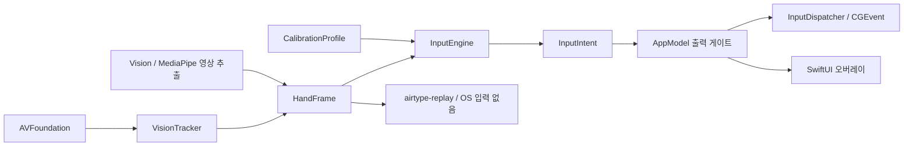

# 아키텍처와 입력 계약

## 구성

`AirtypeCore`는 카메라·화면·권한 API에 의존하지 않는 결정적 라이브러리이다. AppModel은 메인 액터에서 엔진을 순차 호출한다. Vision 추론은 직렬 카메라 큐에서 실행하며 오래된 캡처 프레임을 버린다. UI 관절 표시는 최대 20Hz로 갱신한다.

## 좌표와 파일 형식

HandFrame JSONL v1: 프레임마다 한 줄. `schemaVersion:1`, 초 단위 `timestamp`, `hands` 배열. 각 손은 `side:left|right`, 관절 이름→좌표의 `joints` 사전이다. 카메라 영상은 회전이 정규화된 원본을 사용하고 출력 좌표는 **미러링된 영상, 왼쪽 위 원점, x 오른쪽/y 아래, 0~1**이다.

관절 이름은 wrist, thumbCMC/MCP/IP/Tip, index/middle/ring/little의 MCP/PIP/DIP/Tip이다. z는 선택 사항이며 물리적 접촉 깊이가 아니다. confidence는 제공되는 경우에만 기록한다. MediaPipe의 손 분류 신뢰도를 모든 관절의 신뢰도로 복제하지 않는다. 추정 관절이 화면 밖이면 입력 판단에서 제외한다.

실시간 timestamp는 monotonic uptime이다. 영상 timestamp는 PTS이다. 서로 다른 시간 기준을 섞지 않는다. 추출기 간 프레임 시각 일치와 좌우 손 라벨을 실험 시작 전에 확인한다. MediaPipe의 좌우 정의가 라벨 영상과 다르면 `--swap-handedness`를 명시하고 메타데이터에 남긴다.

CalibrationProfile v1은 board 사각형, 손 크기, 기본 누름 임계값, 좌우 10개 손가락별 임계값을 저장한다. 홈 보정은 안정된 양손 30프레임, 손가락 보정은 각 손가락을 3.5초 동안 움직여 상대 y 변화 폭을 측정한다. 값은 UserDefaults에 로컬 저장되며 카메라 위치/자세 변경 시 재보정한다. **개인별 임계값이 검증된 정확도를 보장하지는 않는다.**

## 상태와 복구

- paused: 카메라가 켜져 있으면 모드 호출만 감지, 입력 없음.
- ready: 보정·재개 대기. 출력 없음.
- choosing: 두 손을 펼쳐 1.5초 유지하면 진입. 선택 영역의 검지 위치를 1초 유지해 모드 선택.
- keyboard: 두 손 필수. 손끝–MCP 상대 y 변화, 속도, 300ms 동작 창을 이용한다. 누름 직전 위치로 키를 선택하고 복귀 전 재입력하지 않는다.
- pointer: 지정한 한 손만 사용. 손이 바뀌었다고 다른 손으로 자동 전환하지 않는다.
- lost: 버튼 해제. 500ms 동안 손을 다시 확인하면 ready로 복귀한다. 활성 모드로 직접 복귀하지 않는다.

250ms 이상 프레임이 오지 않으면 UI 타이머 watchdog가 lost로 전환한다. 캡처가 계속되어도 빈 손 프레임은 즉시 중단한다. 타임스탬프 역전은 무시하고 큰 추적 간격은 연결하지 않는다. 손가락 하나가 가려지면 그 손가락의 누름 궤적을 초기화한다.

동시에 여러 손가락이 움직이면 가장 강한 후보가 다음 후보보다 15% 이상 클 때만 한 키를 확정한다. 이는 초기 규칙 기반 가설이며, 실제 타이핑 속도·연동 움직임에 대한 연구 대상이다. 소프트웨어 테스트가 이 가설의 실사용 정확도를 증명하지 않는다.

## 시스템 입력

실제 출력은 매 실행 기본 OFF다. 활성 카메라와 손쉬운 사용 권한이 있어야 켤 수 있다. 키보드 이벤트는 10개 손가락 보정이 완료되어야 전달한다. 권한이 사라지면 출력 OFF와 버튼 해제를 수행한다. 포커스 변경 시 드래그와 대기 조합키를 해제한다. 앱 자신의 설정 창에는 문자 키를 주입하지 않는다.

조합키는 상태로 보관했다가 다음 key-down/up의 CGEventFlags에 적용한다. 물리 modifier를 지속적으로 누르고 있지 않는다. 한글은 키 코드와 macOS의 설치된 ABC/두벌식 입력 소스를 사용한다. 별도 조합기·클립보드 붙여넣기·입력 로그를 사용하지 않는다. 브라우저 탐색은 Safari·Chrome에서만 Command+[ / ]를 발행한다.

오버레이는 nonactivating panel로 대상 앱의 키보드 포커스를 유지한다. App Sandbox는 활성화하지 않으며 카메라 entitlement와 Developer ID/Hardened Runtime 배포 경로를 사용한다. [Apple Sandbox 제약](https://developer.apple.com/documentation/security/protecting-user-data-with-app-sandbox)

## 연구·엔진 교체

Vision과 MediaPipe는 같은 영상에서 HandFrame을 추출하고, 같은 Swift `airtype-replay`로 판정한다. 엔진별 서로 다른 판정 알고리즘을 비교하는 오류를 피한다. Vision은 제품의 임시 기준 구현이며 최종 채택 결정은 [ADR](adr/0001-native-app-and-tracker-experiments.md)을 따른다.

MediaPipe만 통과할 경우에만 별도 프로세스 통합을 구현한다. 이 경로는 아직 앱에 포함되지 않는다. 처리 프로세스가 카메라를 소유하고 Swift는 관절·상태 메시지만 받도록 하며, 타임아웃·비정상 종료·서명·재시작 시 출력 OFF를 필수로 검증한다.
